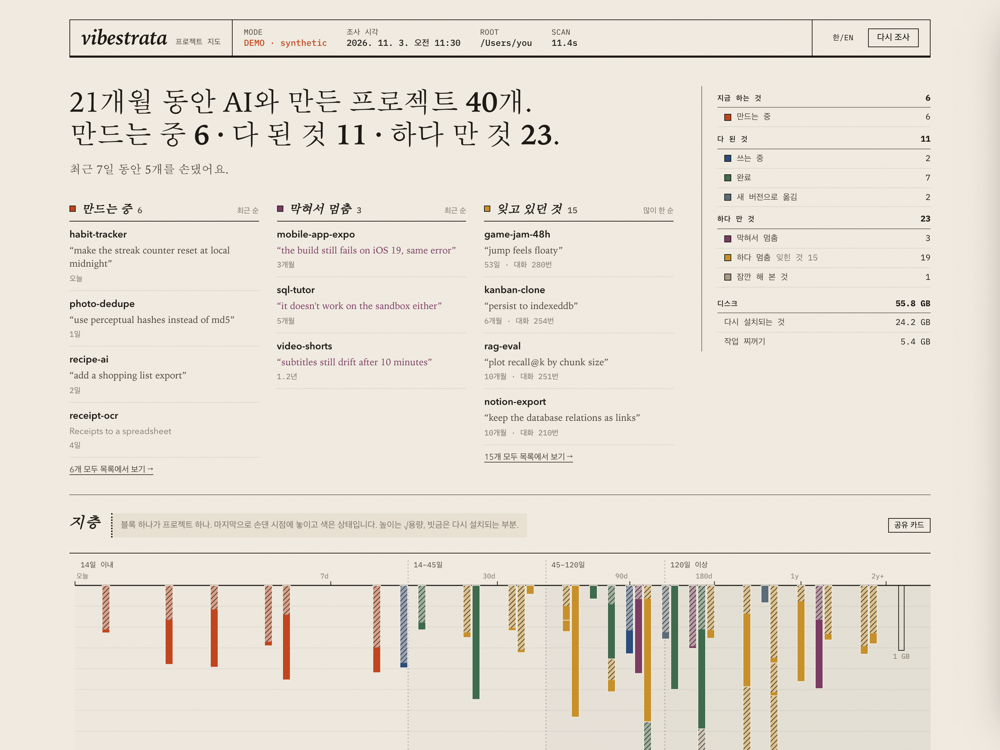
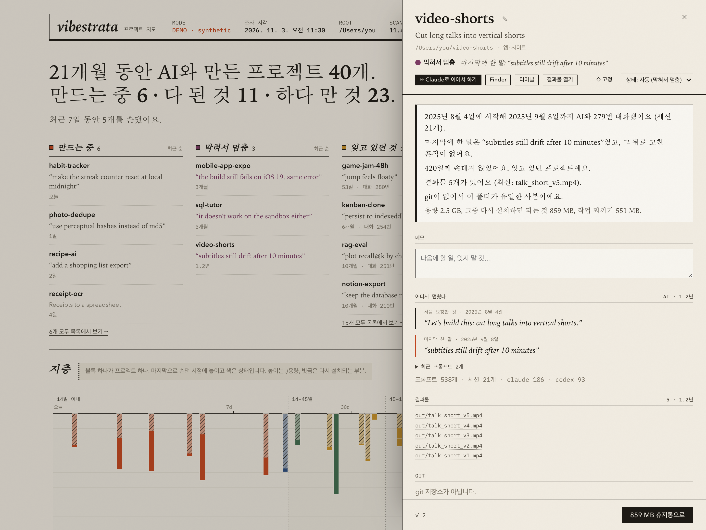
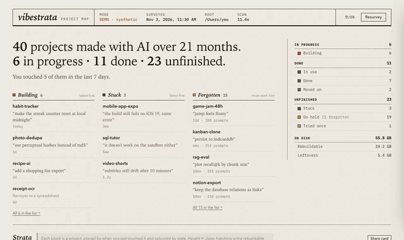

<p align="center"></p>

<h1 align="center"><i>vibestrata</i></h1>
<p align="center"><b>AI와 만든 내 프로젝트들, 한눈에.</b><br>
뭐였는지, 어디까지 했는지, 어디서 막혔고 뭘 잊고 있었는지,<br>
로컬 대시보드와 Claude Code 안에서 보여 줍니다. 정리는 휴지통으로 가고, 언제든 되돌릴 수 있습니다.</p>

<p align="center"><a href="README.md">English</a> · <a href="#설치">설치</a> · <a href="#claude-code-안에서">Claude Code</a> · <a href="#상태">상태</a> · <a href="#절대-하지-않는-것">안전</a></p>

---

Claude Code나 Codex로 몇 달 만들다 보면 홈 폴더가 이렇게 됩니다. `0614`, `udo`, `test`, `landing-v2` 옆의 `landing-v3`. 끝낸 보고서, 매주 쓰는 도구, 마지막 프롬프트에서 깨진 채 멈춘 사이트가 섞여 있는데, 폴더 이름만 봐서는 뭐가 뭔지 모릅니다. "수정한 날짜"도 알려 주지 않습니다.

**vibestrata**는 이미 남아 있는 흔적(파일, git, 에이전트에게 입력한 프롬프트)을 읽어서 지도를 그립니다.

1. **이게 뭐였지?** 모든 폴더에 읽을 수 있는 이름을 붙입니다. `0614`라도 만들어 낸 PDF 이름으로 "AI 전략 워크숍 보고서"라고 부르고, README나 처음 요청한 말로 한 줄 설명을 붙입니다.
2. **지금 어떤 상태지?** 만드는 중인지, 다 된 것(지금도 쓰는 도구, 넘겨준 작업, 새 폴더로 옮겨 간 옛 버전)인지, 하다 만 것(막혀서 멈춤, 하다 멈춤, 잠깐 해 본 것)인지 나눕니다.
3. **어디까지 했지?** 프로젝트마다 몇 문장으로 알려 줍니다. 언제 시작했는지, 마지막에 한 말(*"여전히 깨져"*), 남겨 둔 인계 메모, 만든 결과물, 백업이 되어 있는지. 버튼 하나로 멈춘 곳에서 Claude를 다시 엽니다.
4. **뭘 치워도 되지?** 프로젝트를 체크해서 휴지통으로 보냅니다. 통째로, 또는 `node_modules`·`.venv`처럼 다시 설치되는 것만, 또는 끝난 작업의 초안과 `_workspace` 폴더만. 보내기 전에 경고("git이 없어서 이 폴더가 유일한 사본입니다")를 먼저 보여 주고, 되돌리기도 한 번이면 됩니다.

<p align="center"></p>

## 설치

```bash
npx vibestrata
```

마지막 조사 결과로 터미널에 지도를 먼저 보여 준 뒤 창을 엽니다. Node(npx용)와 Python 3.9 이상이 필요합니다. Python은 macOS 개발자 도구에 들어 있어서, `git`을 쓰고 있다면 이미 있습니다. 표준 라이브러리만 쓰기 때문에 pip로 따로 설치할 것은 없습니다. 프로젝트 90개 정도면 첫 조사는 10~20초 걸립니다.

- **앱으로 쓰기**: `npx vibestrata install-app`을 한 번 실행하면 `~/Applications`에 **Vibestrata**가 생깁니다. Launchpad·Spotlight·Dock에서 열고, 창을 닫으면 종료됩니다.
- **구경만 하기**: `npx vibestrata --demo`는 가상 데이터로 실행하며 디스크를 전혀 읽지 않습니다.
- **다른 설치 방법**: `brew install epoko77-ai/tap/vibestrata`, `pipx install vibestrata`, `pipx install "vibestrata[native]"`(네이티브 창)

```text
vibestrata                    터미널에 지도를 보여 주고 창 열기
vibestrata here [이름]        이 폴더 프로젝트(또는 지정한 프로젝트)를 어디까지 했는지
vibestrata --demo             가상 데이터, 디스크를 읽지 않음
vibestrata scan --summary     마크다운 요약 (채팅에 붙여 넣기 좋음)
vibestrata sweep [--apply]    상태에 맞춘 정리 미리보기 (--apply: 휴지통으로, 되돌리기 명령 출력)
vibestrata undo <op-id>       창 없이도 정리 되돌리기
```

## Claude Code 안에서

vibestrata는 Claude Code 플러그인으로도 설치됩니다.

```text
/plugin install vibestrata --marketplace epoko77-ai/vibestrata
```

(예전 버전: `/plugin marketplace add epoko77-ai/vibestrata` 다음 `/plugin install vibestrata@vibestrata`)

- **돌아왔을 때 알려 주기**: 며칠 손대지 않은 프로젝트에서 Claude Code를 켜면 첫 줄에 어디서 멈췄는지 나옵니다. *"우도 가족여행 가이드북 · 하다 멈춤 · 142일 만에 돌아왔어요. 마지막으로 한 말: “2페이지에 배 시간 넣어줘”"*. Claude도 같은 내용을 알고 시작하기 때문에 "이어서 하자"만 말하면 됩니다. 대시보드를 열 필요가 없습니다. 처음에는 뒤에서 프로젝트를 조사하고(10~20초, 읽기만 함) 다음 세션부터 알려 주며, 그 뒤로는 조사 결과가 12시간보다 오래되면 뒤에서 새로 고칩니다. 최근에 작업한 곳에서는 조용히 있고, `"session_brief": false`로 끌 수 있습니다.
- **`/vibestrata:resume`**: *"여기 어디까지 했지?"*, *"이거 뭐였더라?"*, *"6월에 하던 덱 이어서 하자"*
- **`/vibestrata:survey`**: *"내 프로젝트 현황 보여줘"*, *"잊고 있던 거 뭐 있어?"*, *"막힌 프로젝트 뭐야?"*, *"용량 좀 정리해줘"*. 정리는 미리 보여 주고, 사용자가 좋다고 해야만 실행합니다.
- **`/vibestrata:triage`**: 규칙으로 판단하기 어려운 폴더는 Claude가 프로젝트마다 작은 근거 묶음(최근 프롬프트, 에이전트의 마지막 답, 인계 메모, git 상태, 키는 가림)을 읽고 이름·한 줄 설명·실제 상태를 붙여 저장합니다. 저장되는 것은 그 판정뿐이고 근거 묶음은 남지 않습니다.
- **`/vibestrata:open`**: 창을 엽니다.

## 상태

파일, git, 내가 입력한 프롬프트로 먼저 추정한 것입니다. 틀리면 한 번에 바꾸면 되고, 직접 고른 상태가 항상 우선합니다.

| | 상태 | 언제 | vibestrata는 |
|---|---|---|---|
| **지금 하는 것** | **만드는 중** | 최근 14일 안에 코드나 파일을 고침 | 건드리지 않습니다 |
| **다 된 것** | **쓰는 중** | 다 만들어서 지금도 쓰는 것: 스킬·자동 실행·MCP 서버·셸 별칭이 이 폴더를 쓰거나, 코드는 그대로인데 결과물이 계속 나옴 | 건드리지 않고, 무엇이 이 폴더를 쓰는지 알려 줍니다 |
| | **완료** | 넘기고 끝냄(*"나머진 내가 할게"*), 깔끔하게 푸시함, 또는 마지막에 결과물을 만듦 | 작업 찌꺼기(초안, `_workspace`)를 치워도 된다고 알려 줍니다 |
| | **새 버전으로 옮김** | 더 새 폴더가 이어받음: `landing-v2` → `landing-v3`, 또는 같은 저장소에 올리는 두 폴더 | 새 폴더를 확인했다면 옛 폴더를 치워도 됩니다 |
| **하다 만 것** | **막혀서 멈춤** | 마지막에 한 말이 끝내 해결 못 한 문제(*"여전히 안 돼"*, *"똑같아"*)이거나 누군가를 기다리는 중 | 그 말을 보여 줍니다. 다시 열면 여기서부터 |
| | **하다 멈춤** | 중간에 손을 놓음. 45일이 넘으면 '잊힌 것'으로 봄 | 메모나 마지막 말을 보여 줍니다 |
| | **잠깐 해 본 것** | 하루 이틀, 프롬프트 몇 개로 끝남 | 대개 통째로 휴지통에 보내도 됩니다 |
| | **접음** | 사용자(또는 triage 스킬)만 지정 | |

**규칙이 일부러 무시하는 것**은 실제 프롬프트 수천 개에서 배웠습니다. "중간저장" 같은 습관은 상태와 관계없이 대부분의 세션 끝에 나오고, "고생했어"는 절반쯤 "내일 계속하자"와 함께 나오며, "캔슬하자"는 대개 프로젝트가 아니라 한 번의 실행을 버리는 말입니다. 그래서 마무리 인사만으로 "끝났다"고 판단하지 않습니다.

## 할 수 있는 것

<p align="center"></p>

| | |
|---|---|
| **지도** | 맨 위 한 문장(*"21개월 동안 AI와 만든 프로젝트 40개. 만드는 중 6 · 다 된 것 11 · 하다 만 것 23."*) 아래에 세 칸이 있습니다. **만드는 중**(지금 무엇을 하고 있는지), **막혀서 멈춤**(멈춘 그 말), **잊고 있던 것**(많이 해 둔 것부터). 그 아래에는 상태별로 묶은 모든 프로젝트가 이름, 종류(앱·사이트, 문서, 도구), 한 줄 설명, 어디서 멈췄는지와 함께 나옵니다. |
| **프로젝트 화면** | 지금 상황을 몇 문장으로, 내 메모(*"다음: 모바일 레이아웃 고치기"*), 처음과 마지막에 한 말, 인계 메모, 바로 열 수 있는 결과물, GitHub·배포 주소, git 상태, 용량 구성. 이름 바꾸기, 상태 바꾸기, 고정. |
| **이어서 하기** | *Claude로 이어서 하기*는 그 폴더의 마지막 대화를 다시 엽니다(Codex 프로젝트는 `codex resume`). 끝난 작업은 *Claude로 다시 손보기*가 지금 상태부터 읽고 시작하는 새 대화를 엽니다. |
| **찾기** | 이름, 설명, 메모, 파일 이름, 내가 했던 말까지 검색합니다. *"배 시간 넣던 거"* |
| **골라서 정리** | 프로젝트를 체크해서 통째로, 또는 다시 설치되는 것만, 또는 작업 찌꺼기만 휴지통으로 보냅니다. 위험한 것(백업 없음, 스킬이 쓰는 폴더, 쓰는 중)은 *경고를 확인했습니다*를 체크해야 보낼 수 있습니다. |
| **지층** | 프로젝트 하나가 블록 하나. 마지막으로 손댄 시점에 놓이고(왼쪽이 오늘, 오른쪽이 2년 전) 색은 상태입니다. 높이는 √용량, 빗금은 다시 설치되는 부분. |
| **공유 카드** | *"21개월, AI와 만든 프로젝트 40개."*와 지층을 담은 1200×630 이미지. 이름은 기본으로 가리고, 업로드하지 않습니다. |
| **기록** | 치운 것은 모두 기록됩니다. 휴지통을 비우기 전까지 **되돌리기**로 원래 자리에 정확히 돌아옵니다. |

## 절대 하지 않는 것

> - **바로 삭제하지 않습니다.** 같은 디스크의 시스템 휴지통(`~/.Trash`)으로 이름만 바꿔 옮기고, 옮기기 전에 기록부터 남깁니다. 되돌리기는 그 반대로 옮깁니다. 실제로 공간이 확보되는 휴지통 비우기는 사용자가 합니다.
> - **네트워크를 쓰지 않습니다.** 수집, 폰트, CDN 모두 없습니다. 서버는 `127.0.0.1`에만 열립니다.
> - **조사 결과를 그대로 믿지 않습니다.** 옮기기 직전에 안전장치를 모두 다시 확인하고, 조사 이후 바뀐 것은 건너뜁니다.
> - **계속 떠 있지 않습니다.** 창을 닫으면 종료되고, 로그인 항목이나 상주 프로그램이 없습니다. 저절로 실행되는 것은 Claude Code 플러그인의 세션 시작 확인 하나뿐입니다. 조사 결과가 없거나 12시간보다 오래됐을 때 읽기 전용 조사를 낮은 우선순위로 한 번 돌리고 끝납니다. 삭제하려면 `~/.vibestrata`와 `~/Applications/Vibestrata.app`을 지우면 됩니다.

git이 추적하는 파일, 재설치를 증명할 lockfile·manifest가 없는 폴더, 실행 중인 프로그램이 쓰는 폴더, 심볼릭 링크, iCloud 폴더, 홈 폴더 자체, 다른 프로젝트를 품은 폴더는 옮기지 않습니다. 자세한 규칙은 [영문 README](README.md#how-it-decides)에 있습니다.

## 설정

`~/.vibestrata/config.json`이 첫 실행 때 만들어집니다. `roots`(찾을 폴더), `thresholds`(만드는 중 14일, 잊힌 것 45일), `claude_prompts`(false면 프롬프트 내용을 어디에도 표시하지 않음), `session_brief`·`session_brief_days`(Claude Code의 "돌아왔어요" 알림), `session_survey_hours`(플러그인이 뒤에서 조사를 새로 고치는 주기, 기본 12시간), `editor_command`(예: `"cursor {path}"`)를 바꿀 수 있습니다.

## 라이선스

MIT
