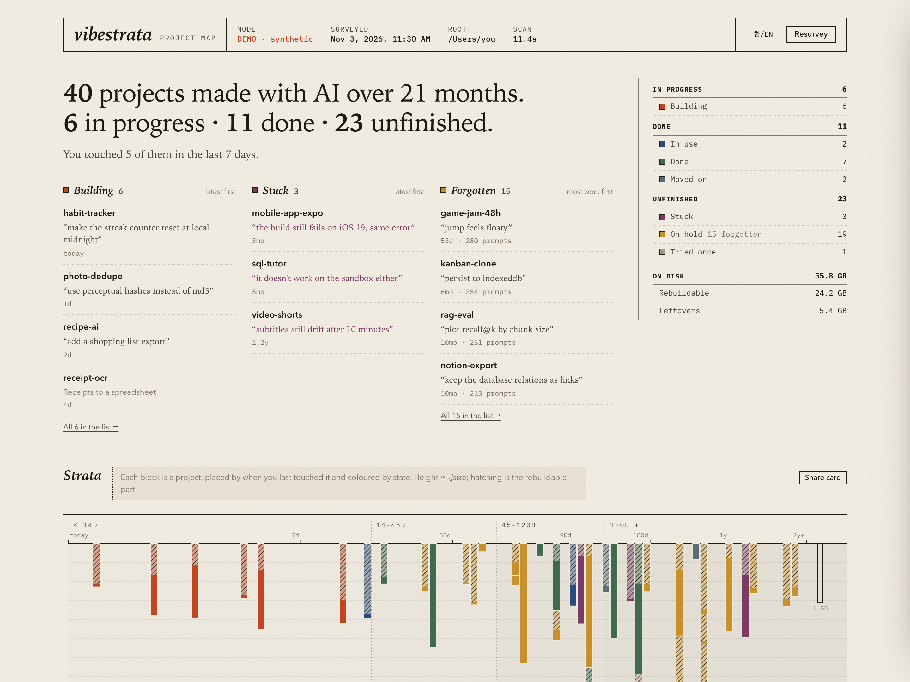
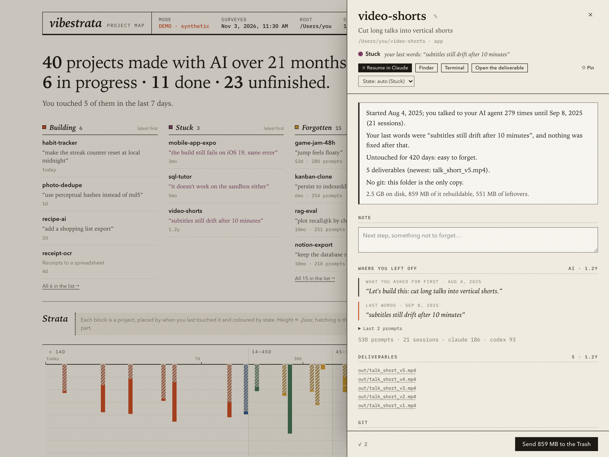
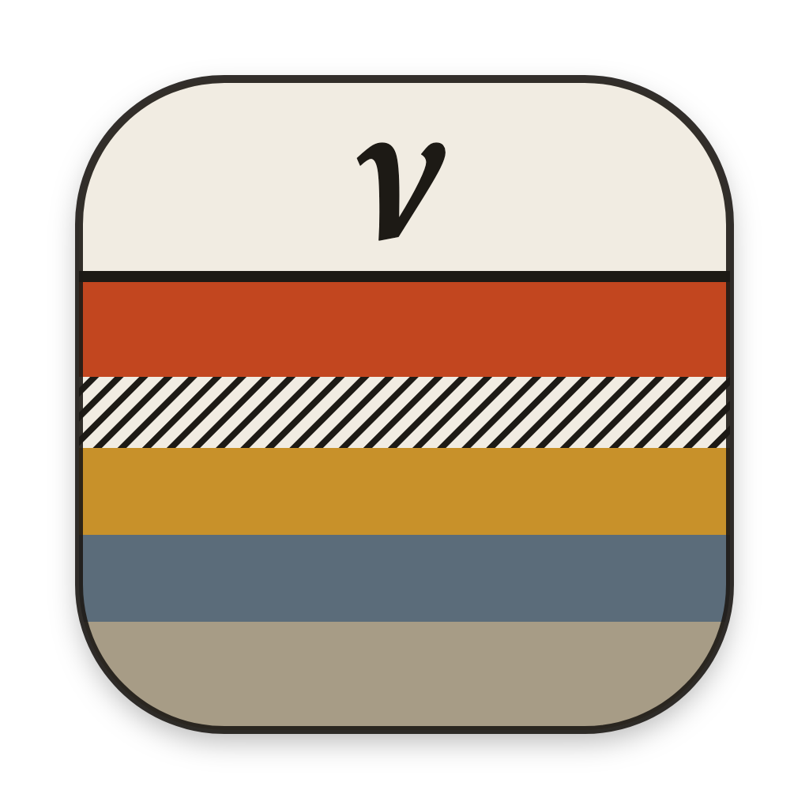
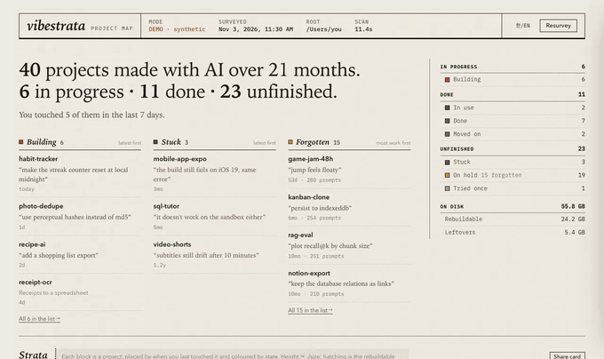

<p align="center"></p>

<h1 align="center"><i>vibestrata</i></h1>
<p align="center"><b>Your AI-made projects, at a glance.</b><br>
What each one is, where you left off, what's stuck and what you forgot,<br>
on a local dashboard and inside Claude Code. Cleanup goes to the Trash, always undoable.</p>

<p align="center"><a href="README.ko.md">한국어</a> · <a href="#install">Install</a> · <a href="#inside-claude-code">Claude Code</a> · <a href="#states">States</a> · <a href="#what-it-never-does">Safety</a></p>

---

Build with Claude Code or Codex for a few months and your home folder fills up: `0614`, `udo`, `test`, `landing-v2` next to `landing-v3`, a report you finished, a tool you use every week, a site that broke on the last prompt and never got fixed. The folder names don't say which is which. Neither does "last modified".

**vibestrata** reads what you already left behind (your files, git, and the prompts you typed to your agents) and draws the map:

1. **What is this?** A readable name for every folder, even `0614` ("Board Offsite AI Strategy Review", from the PDF it produced), with one line on what it is (from its README, or the first thing you asked for).
2. **Where does it stand?** In progress, or done (a tool you still use, a job you handed over, a version a newer folder replaced), or unfinished (stuck on a bug, on hold, tried once).
3. **Where did I leave off?** A few plain sentences per project: when it started, the last thing you said (*"subtitles still drift after 10 minutes"*), your hand-off note, what it produced, whether it's backed up. One click opens it in Claude where you stopped.
4. **What can go?** Tick projects and send them to the Trash: whole, or just their `node_modules`/`.venv`, or just the drafts and `_workspace` folders a finished job left behind. You see the warnings first ("no git: this folder is the only copy"), and undo is one click.

<p align="center"></p>

## Install



```bash
npx vibestrata
```

It prints the map in your terminal (from the last survey), then opens the window. You need Node (for `npx`) and Python 3.9+, which comes with the macOS developer tools (if you have `git`, you have it). vibestrata uses only the Python standard library, so there's nothing to pip install. The first survey of ~90 projects takes 10–20 seconds.

**Make it an app.** `npx vibestrata install-app` puts **Vibestrata** in `~/Applications`, so it opens from Launchpad, Spotlight or the Dock. It runs in its own window and quits when you close it.

**Just looking?** `npx vibestrata --demo` runs on synthetic data and reads nothing from your disk.

<details><summary>Other ways to install (Homebrew, pipx, uv)</summary>

```bash
brew install epoko77-ai/tap/vibestrata
pipx install vibestrata              # or: uv tool install vibestrata
pipx install "vibestrata[native]"    # adds pywebview for a native window
```
</details>

```text
vibestrata                    the map in your terminal, then the window
vibestrata here [name]        where you left off in this folder's project (or a named one)
vibestrata install-app        add Vibestrata.app (macOS) or a desktop entry (Linux)
vibestrata --demo             synthetic data, nothing on disk is read
vibestrata --rescan           open and resurvey
vibestrata scan --summary     Markdown summary (great for pasting into a chat)
vibestrata scan --json        everything, for scripts
vibestrata sweep              preview a cleanup that follows each project's state
vibestrata sweep --apply      do it: to the Trash (prints the undo command)
vibestrata ops                list past cleanups
vibestrata undo <op-id>       put a cleanup back, even without the window
vibestrata evidence <name>    the ≤ 4 KB evidence pack the triage skill reads
vibestrata label <name> …     store a reading (state, name, summary) for a project
```

## Inside Claude Code

vibestrata ships as a Claude Code plugin:

```text
/plugin install vibestrata --marketplace epoko77-ai/vibestrata
```

(On older versions: `/plugin marketplace add epoko77-ai/vibestrata`, then `/plugin install vibestrata@vibestrata`.)

- **You're back.** Open Claude Code in a project you haven't touched for a few days and the first line tells you where it stood: *"Udo Family Trip Guide · On hold · You've been away 142 days. Last thing you asked: “add the ferry times to page 2”"*. Claude gets the same few lines as context, so "let's continue" just works. It needs no dashboard: the first time, it maps your projects in the background (10–20 s, read-only) and starts talking from the next session; after that it refreshes the map behind you when it's more than 12 hours old. It stays silent when you were there recently, and turns off with `"session_brief": false`.
- **`/vibestrata:resume`**: *"where did I leave off here?"*, *"what was this project?"*, *"let's continue the deck from June"*.
- **`/vibestrata:survey`**: *"what am I working on?"*, *"what did I forget?"*, *"what was I stuck on?"*, *"free up some disk"*. Cleanups are previewed and only run after you say yes.
- **`/vibestrata:triage`**: for the folders the rules can't settle, Claude reads a small evidence pack per project (your last prompts, the agent's last reply, the hand-off note, git state; credentials redacted), then stores a readable name, a one-line summary and what it really is. Only that verdict is saved, never the pack.
- **`/vibestrata:open`** opens the window.

## States

A first guess from your files, git and your own prompts. Wrong? Change it in one click; your choice always wins.

| | state | when | vibestrata… |
|---|---|---|---|
| **In progress** | **Building** | code or files changed in the last 14 days | leaves it alone |
| **Done** | **In use** | a finished tool: a skill, launch agent, MCP server or shell alias points at it, or its outputs keep changing while its code doesn't | leaves it alone, and says what depends on it |
| | **Done** | handed over (*"I'll take it from here"*, *"나머진 내가 할게"*), pushed clean, or the deliverable was written at the very end | offers its leftovers (drafts, `_workspace`) |
| | **Moved on** | a newer folder took over: `landing-v2` → `landing-v3`, or two folders pushing to the same repo | offers the old folder once you've checked the new one |
| **Unfinished** | **Stuck** | the last thing you said was a problem that never got fixed (*"still broken"*, *"same error"*, *"여전히 안 돼"*), or a wait on someone | quotes it, so you know where to pick up |
| | **On hold** | stopped mid-way; after 45 days it counts as *forgotten* | shows your note or last words |
| | **Tried once** | a handful of prompts over a day or two | usually fine to bin whole |
| | **Dropped** | only you (or the triage skill) say so | |

**What the rules deliberately ignore**, learned from thousands of real prompts: checkpoint rituals (*"save progress"*, *"중간저장"*) end most sessions whatever the state; *"thanks"* sits next to *"let's continue tomorrow"* half the time; *"cancel that"* usually scraps one run, not the project. So vibestrata never infers that you're *done* from closing words alone.

Flags sit on top: **no backup / unsaved** (no git, uncommitted or unpushed work), **registered** (another config points at the folder), **live** (it has a deployed address).

## What you get

<p align="center"></p>

| | |
|---|---|
| **The map** | One sentence on top (*"40 projects made with AI over 21 months: 6 in progress · 11 done · 23 unfinished"*), then three columns: what you're **building** (with what you're on now), what's **stuck** (with the words it stopped on), and what you **forgot** (the ones you put the most into first). Below, every project grouped by state, each with its readable name, kind (app · document · tool), one line on what it is, and where it stopped. |
| **Project page** | A few plain sentences on where it stands, your note (*"next: fix the mobile layout"*), the first and last thing you asked, the hand-off note, deliverables you can open, GitHub and deployed links, git state, and what's taking space. Rename it, change its state, pin it. |
| **Resume** | *Resume in Claude* reopens the last conversation in that folder (`claude --resume`, or `codex resume` for Codex projects). For finished work, *Revisit with Claude* starts a fresh session that first reads where things stand. |
| **Find anything** | Search covers names, summaries, your notes, file names, and what you asked: *"that thing with the ferry times"*. |
| **Select and clean** | Tick any projects. Send them to the Trash whole, or only what rebuilds (`node_modules`, `.venv`, caches), or only the leftovers of finished work. Risky ones (no backup, a skill depends on it, still in use) need an explicit *I've read the warnings*. |
| **Strata** | Each project is a block placed by when you last touched it: today on the left, two years ago on the right, coloured by state. Height is √size; the hatched part rebuilds. |
| **Share card** | A 1200×630 PNG, *"40 projects with AI in 21 months"*, with your strata. Names hidden by default; nothing is uploaded. |
| **Log** | Every removal is journaled. **Undo** puts things back exactly where they were until you empty the Trash. |

Korean and English UI. Toggle with 한/EN.

## What it never does

> - **Never deletes.** Removals are *renamed* into the system Trash on the same disk (`~/.Trash`), with a journal written before the first move. Undo renames them back. Emptying the Trash, which is when the space returns, is yours to do.
> - **Never touches the network.** No telemetry, no fonts, no CDN. The server binds to `127.0.0.1` only.
> - **Never trusts the scan at action time.** Every guard below is re-checked right before the move, and anything you changed since the survey is skipped.
> - **Never stays running.** The window quits when you close it. No login item, no daemon. The one thing that starts on its own is the Claude Code plugin's session check: when the survey is missing or over 12 hours old, it runs one read-only survey at low priority and exits. To uninstall, delete `~/.vibestrata` and `~/Applications/Vibestrata.app`.

The local server requires a per-launch random token (swapped for a `SameSite=Strict` cookie), checks a header token on every mutation, rejects foreign `Host` and `Origin` headers, and acts only on projects it surveyed.

## How it decides

**Names.** The project's own README/CLAUDE.md title (skipping framework boilerplate and lines about the file itself); else the name of the document it produced (`AI_전략_워크숍_보고서.pdf` → *AI 전략 워크숍 보고서*; Korean file names are normalised from macOS's decomposed form); else the folder name. The one-line summary is the README's first real paragraph or the first thing you asked for (skipping *"check my skills"*, `git clone`, pasted blobs).

**Agent activity.** `~/.claude/history.jsonl` and the `cwd` recorded inside `~/.claude/projects/*/*.jsonl` (folder names are never decoded; the encoding changed between versions). For Codex, the `session_meta` line of each `~/.codex/sessions/**` file (cached in `~/.vibestrata`) and `~/.codex/history.jsonl`. Activity in a subfolder counts toward the project that owns it. Anything that looks like a key or token is redacted.

**What counts as a project.** Every folder under your roots (default `~`, `~/code`, `~/projects`, `~/dev`, `~/src`, `~/work`, `~/repos`, `~/Developer`), skipping `Library`, `Documents`, `Downloads` and friends. A folder with a marker (`.git`, `package.json`, `pyproject.toml`, `CLAUDE.md`, `.claude/`, `README`, `index.html`, `*.ipynb`…) is a project; a folder of marked subfolders is a *group*; any other non-empty folder still counts.

**What rebuilds.** Only folders something next to them *proves* rebuildable count: `node_modules` + `package.json`, `.venv` with `pyvenv.cfg`, `.next` in a Next.js app, `target` + `Cargo.toml`, `__pycache__`, `.pytest_cache`, `.turbo`… `dist`/`build`/`out` are opt-in, because sometimes they're the deliverable.

**Guards.**

| # | guard |
|---|---|
| G1 | **Git-tracked content is never touched.** Inside a repo, a folder only qualifies if `git check-ignore` matches it or `git ls-files` lists nothing under it. `.git`, `.claude`, `.env*` are always protected. |
| G2 | **Proof is required.** A `node_modules` without a `package.json` is shown but blocked. |
| G3 | **No in-use folders.** One `lsof` + `ps` pass before each action skips anything a running process lives in. |
| G4 | **Same volume only.** The Trash (or, without one, a quarantine folder) is on the same disk; vibestrata never copies and then deletes. |
| G5 | **Symlinks are never followed.** |
| G6 | **iCloud / File Provider folders are read-only.** Sizes use allocated blocks; hard links count once. |
| G7 | **Whole projects go only as themselves**, never your home folder, never a folder that holds other projects. |
| G8 | **Restore never clobbers.** If the path exists again, the restored copy lands next to it as `name.restored-<time>`. |

The rules live in `vibestrata/segment.py` (states) and `vibestrata/identity.py` (names), with the evidence for each threshold in their docstrings.

## Configure

`~/.vibestrata/config.json` is created on first run:

```json
{
  "roots": ["~", "~/code", "~/projects"],
  "skip": ["Library", "Documents", "Downloads", "..."],
  "thresholds": { "active": 14, "cooling": 45, "dormant": 120 },
  "big_file_mb": 20,
  "claude_prompts": true,
  "session_brief": true,
  "session_brief_days": 3,
  "session_survey_hours": 12,
  "editor_command": "cursor {path}"
}
```

`active` is the *Building* window; `cooling` is when an idle project counts as forgotten; `dormant` only draws a band on the chart. `claude_prompts: false` hides prompt text everywhere. `session_brief` is the Claude Code "you're back" line, shown after `session_brief_days` away; the plugin refreshes the survey in the background once it is `session_survey_hours` old.

## Compared to

| | vibestrata | [npkill](https://github.com/voidcosmos/npkill) | [kondo](https://github.com/tbillington/kondo) |
|---|---|---|---|
| Readable names for unnamed folders | ✓ | — | — |
| Where you left off (your prompts, hand-off notes) | ✓ | — | — |
| States: in use, done, stuck, on hold… | ✓ | — | — |
| Resume in Claude / Codex | ✓ | — | — |
| Projects without git | ✓ | — | ✓ |
| Removal | Trash + undo | delete | delete |
| Proof / git-tracked / in-use guards | ✓ | — | — |
| UI | local web + Claude Code | TUI | CLI / GUI |

If you just want to nuke `node_modules` fast, npkill and kondo are great. vibestrata is for when you want to *see* your projects first.

## Platform

macOS is the primary target (Trash, Terminal, `claude --resume`). Linux works too, with the freedesktop Trash. Windows isn't supported yet; PRs are welcome.

## Develop

```bash
git clone https://github.com/epoko77-ai/vibestrata && cd vibestrata
python -m vibestrata --demo            # UI on synthetic data
python -m unittest discover -s tests -v
claude plugin validate .               # Claude Code marketplace + plugin
```

There's no build step. The UI is `vibestrata/static/` (vanilla JS + CSS), the terminal and Claude Code text is `vibestrata/brief.py`, the npm launcher is `bin/vibestrata.js`, and the Claude Code plugin is `plugin/`. All disk-mutating code lives in `vibestrata/actions.py`. Releases: [docs/RELEASING.md](docs/RELEASING.md).

## License

MIT
